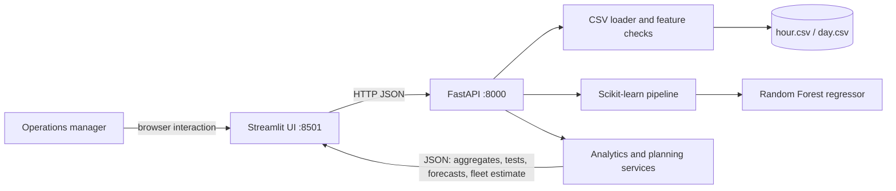

# CycleSight Architecture

## System view

## Responsibilities

**Streamlit** owns the user experience: executive overview, demand exploration, hypothesis interpretation, model-driven fleet planning, and a rule-based natural-language scenario interface. It sends requests to FastAPI and presents the returned values and caveats. `BIKE_API_URL` configures the service URL.

**FastAPI** owns data access and analytical computation. It reads the hourly CSV, derives labels and the rush-hour flag, calculates summary series, trains and caches the model, validates prediction inputs with Pydantic, and exposes JSON endpoints. `BIKE_DATA_DIR` configures the CSV directory.

**Model** uses a chronological 80/20 date split. Categorical calendar and weather features are one-hot encoded; normalized weather measurements are imputed and scaled. A Random Forest regressor estimates `cnt`. Target counts and post-rental user counts are excluded from the predictors. Holdout MAE, RMSE, and R² are calculated when the model is first loaded and surfaced in `/health` and the UI.

**Planning service** converts a predicted hourly rental count into a rough concurrent-bike requirement using assumed average trip duration, demand buffer, and maintenance reserve. Formula: `ceil(predicted rentals × (1 + buffer) × trip hours ÷ (1 − reserve share))`.

## Request flow

1. A manager opens a view or submits a scenario in Streamlit.
2. The frontend calls `/overview`, `/hypothesis`, `/predict`, `/fleet`, or `/ask` over HTTP.
3. FastAPI validates inputs, reads cached data, and loads the cached model only for model-backed requests.
4. The backend responds with values, assumptions, and evaluation metadata as JSON.
5. Streamlit renders the result and states the limitations beside fleet estimates.

## Local deployment

Run the API and Streamlit as separate processes. For a single machine, CORS is enabled for local development. In a hosted deployment, set the frontend's `BIKE_API_URL` to the API origin, restrict CORS to the frontend origin, and provide CSVs through a mounted data directory. Add authentication, request logging, and a managed model artifact before exposing the service publicly.

## Evidence boundary

The dataset covers aggregate completed rentals in Washington, D.C. for 2011–2012. It does not include station-level availability, trip durations, attempted-but-denied rentals, or bike movements. Forecasts can support *when* planning; they cannot say *where* to rebalance or determine whether total fleet size is sufficient. The p-value uses a large-sample normal approximation and should be read descriptively because hourly demand is temporally dependent.
